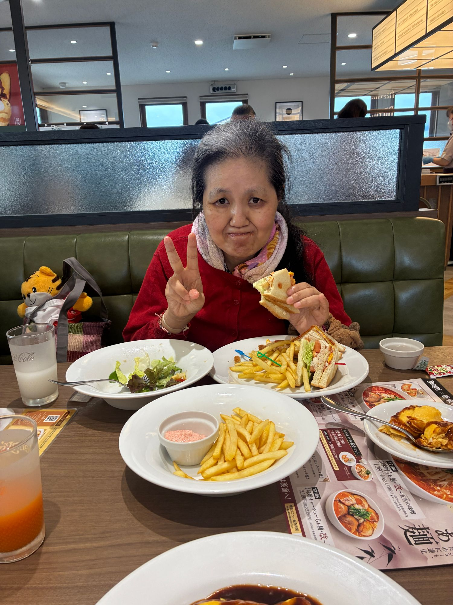
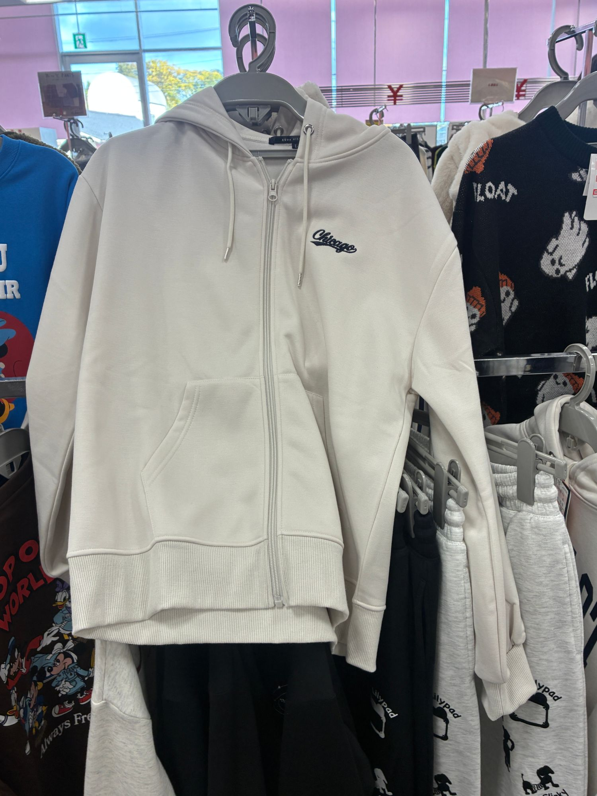
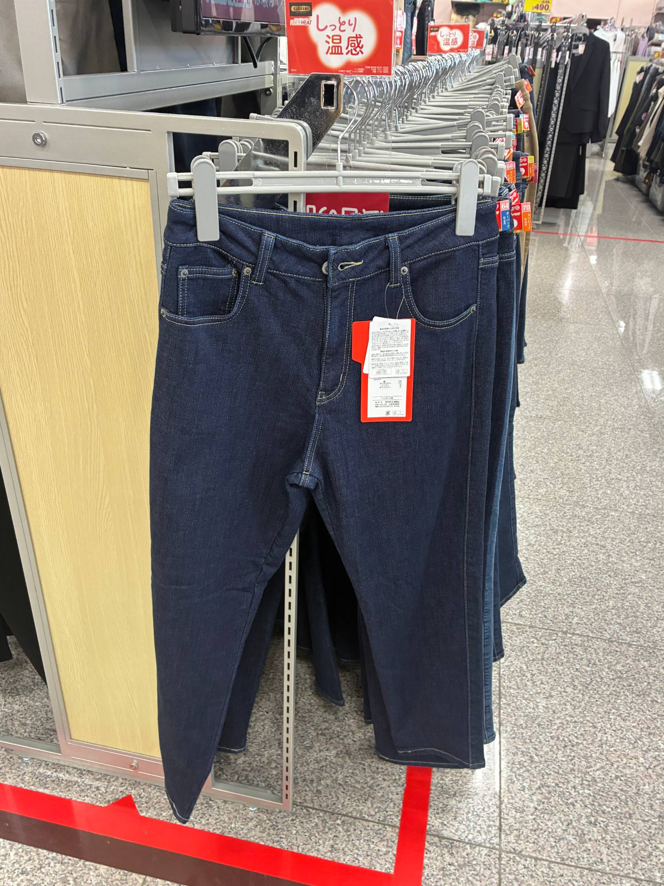

# 同行報告書

- お客様名：飯田様
- 日付：2026年11月18日
- 内容：買い物同行

## 報告内容

デニーズでクラブハウスサンドのランチとデザートにホットケーキを召し上がりました。ホットケーキはあまり好みではなかったようです。

その後パシオスとしまむらに行き、気に入ったお洋服を見つけることができました。帰りに別のお店でデジタルタイプの目覚まし時計も購入しました。

15分ほど時間はオーバーしましたが、今日の買いたかったものは全て買えました。

## 写真

